

# 🚦 PABOMORL

### Risk-Guided Pareto Policy Learning for Safety-Critical Driving Scenario Generation

**Yanzhan Chen · Zhaoxiang Chen · Xin Shi · Linhuan Zhong**

🧠 **Multi-Objective Reinforcement Learning** &nbsp; · &nbsp;
🎮 **CARLA Simulation** &nbsp; · &nbsp;
⚖️ **Hazard–Naturalness Trade-offs**

 

**[🎬 Scenario Gallery](#-scenario-gallery)** &nbsp; / &nbsp;
**[🗂️ Collision Library](#️-collision-scenario-library)** &nbsp; / &nbsp;
**[🔬 Method](#-method-overview)** &nbsp; / &nbsp;
**[📦 Release](#-code--model-release)**

---

> 🚧 **Code and pretrained models will be released after the manuscript is accepted.**
>
> This repository currently presents visualization examples of generated safety-critical driving scenarios.

## 🔎 Overview

Generating useful safety-critical scenarios requires more than increasing collision frequency. The interactions should also retain plausible driving behavior and expose diverse failure patterns.

**PABOMORL** formulates scenario generation as a multi-objective learning problem that balances **hazard** and **behavioral naturalness**. An ego-centric driving risk field supplies continuous interaction-risk feedback, while a natural-driving prior regularizes adversarial behavior. Pareto-aware Bayesian optimization adaptively selects preferences to learn policies with different hazard–naturalness trade-offs.

**Continuous risk feedback** &nbsp; × &nbsp;
**Natural-driving regularization** &nbsp; × &nbsp;
**Adaptive preference exploration**

### 📊 Experimental Snapshot

| Randomly Initialized Scenarios | Generated Collision Scenarios | Collision Rate | CARLA Maps |
| :---: | :---: | :---: | :---: |
| **5,000** | **3,935** | **78.7%** | **5** |

  Aggregate results reported in the manuscript.

---

## 🎬 Scenario Gallery

Seven representative cases are presented from two complementary perspectives.

- **Left — Bird’s-eye view:** vehicle configurations and interaction trajectories.
- **Right — First-person view:** the corresponding scene from an onboard perspective.

**BEV is always displayed first.**

### 🎞️ Case 01

<table>
  <tr>
    <th align="center" width="50%">🛰️ Bird’s-Eye View</th>
    <th align="center" width="50%">🚘 First-Person View</th>
  </tr>
  <tr>
    <td align="center" width="50%">
      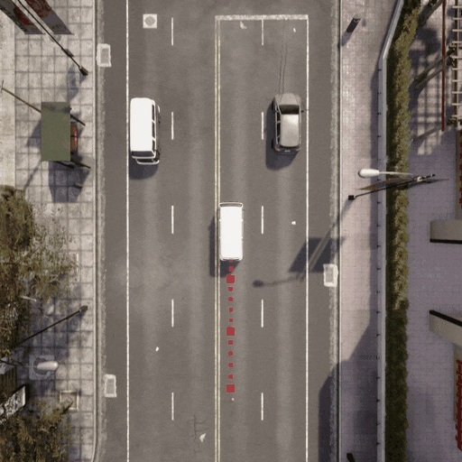
    </td>
    <td align="center" width="50%">
      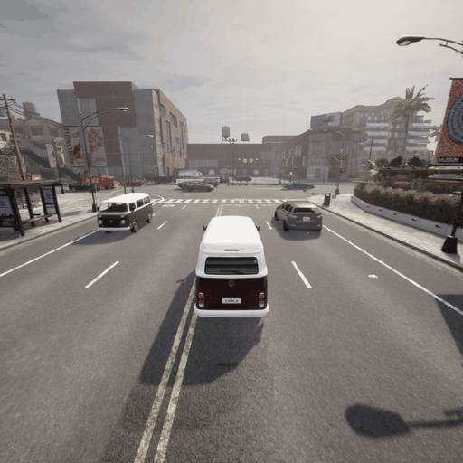
    </td>
  </tr>
</table>

### 🎞️ Case 02

<table>
  <tr>
    <th align="center" width="50%">🛰️ Bird’s-Eye View</th>
    <th align="center" width="50%">🚘 First-Person View</th>
  </tr>
  <tr>
    <td align="center" width="50%">
      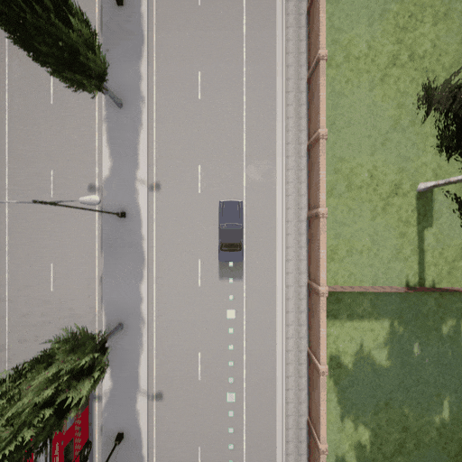
    </td>
    <td align="center" width="50%">
      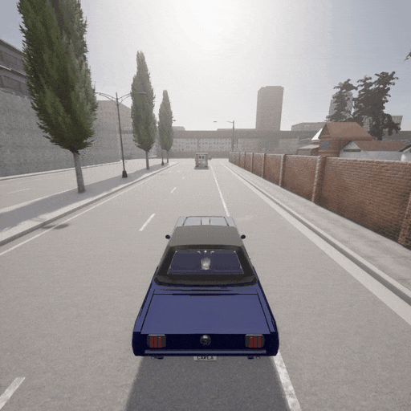
    </td>
  </tr>
</table>

### 🎞️ Case 03

<table>
  <tr>
    <th align="center" width="50%">🛰️ Bird’s-Eye View</th>
    <th align="center" width="50%">🚘 First-Person View</th>
  </tr>
  <tr>
    <td align="center" width="50%">
      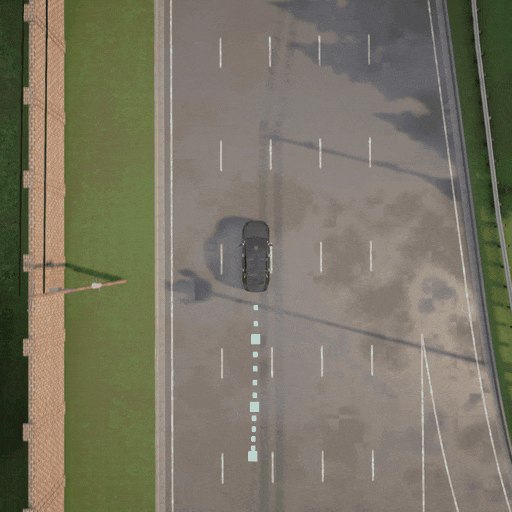
    </td>
    <td align="center" width="50%">
      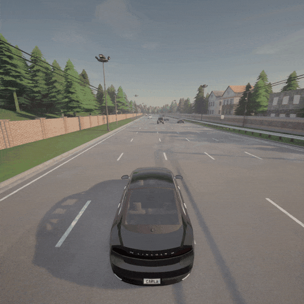
    </td>
  </tr>
</table>

### 🎞️ Case 04

<table>
  <tr>
    <th align="center" width="50%">🛰️ Bird’s-Eye View</th>
    <th align="center" width="50%">🚘 First-Person View</th>
  </tr>
  <tr>
    <td align="center" width="50%">
      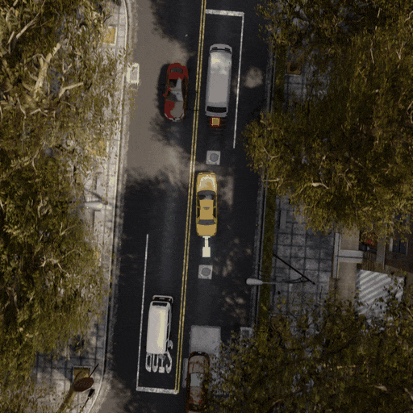
    </td>
    <td align="center" width="50%">
      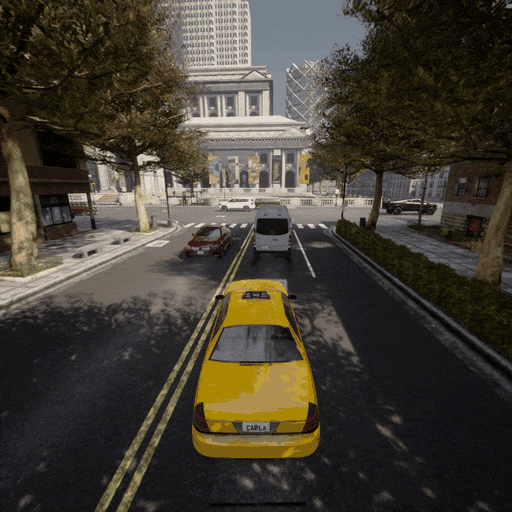
    </td>
  </tr>
</table>

### 🎞️ Case 05

<table>
  <tr>
    <th align="center" width="50%">🛰️ Bird’s-Eye View</th>
    <th align="center" width="50%">🚘 First-Person View</th>
  </tr>
  <tr>
    <td align="center" width="50%">
      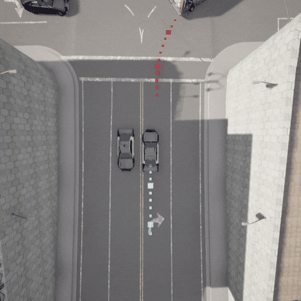
    </td>
    <td align="center" width="50%">
      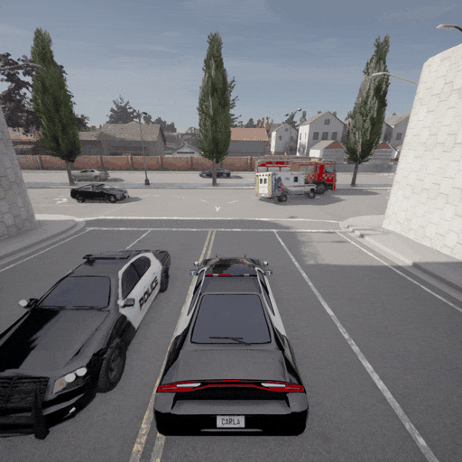
    </td>
  </tr>
</table>

### 🎞️ Case 06

<table>
  <tr>
    <th align="center" width="50%">🛰️ Bird’s-Eye View</th>
    <th align="center" width="50%">🚘 First-Person View</th>
  </tr>
  <tr>
    <td align="center" width="50%">
      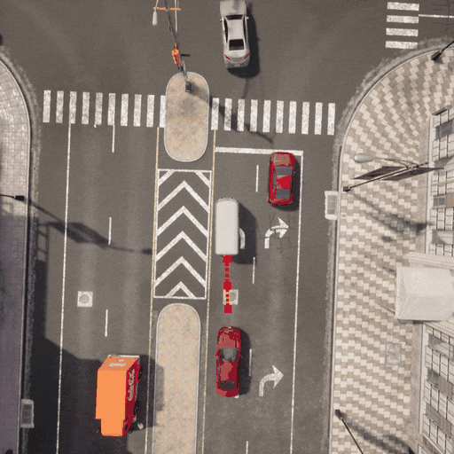
    </td>
    <td align="center" width="50%">
      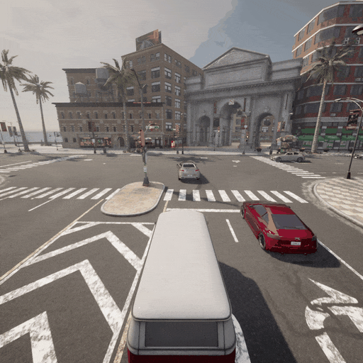
    </td>
  </tr>
</table>

### 🎞️ Case 07

<table>
  <tr>
    <th align="center" width="50%">🛰️ Bird’s-Eye View</th>
    <th align="center" width="50%">🚘 First-Person View</th>
  </tr>
  <tr>
    <td align="center" width="50%">
      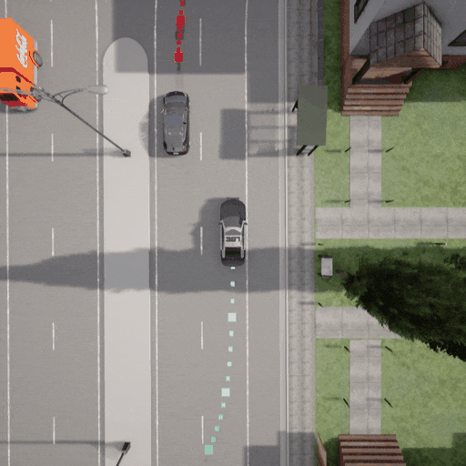
    </td>
    <td align="center" width="50%">
      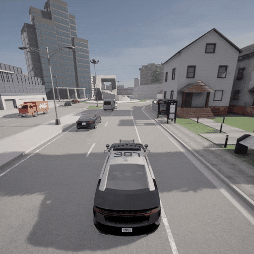
    </td>
  </tr>
</table>

---

## 🗂️ Collision Scenario Library

The generated library contains **3,935 collision scenarios** collected across five CARLA maps:

**`Town03`** &nbsp; **`Town04`** &nbsp; **`Town06`** &nbsp; **`Town10`** &nbsp; **`Town15`**

The scenarios cover diverse road layouts, vehicle configurations, and collision mechanisms, including lateral, crossing, and longitudinal conflicts.

  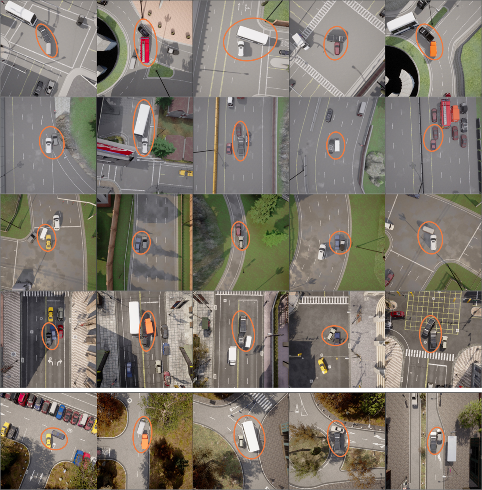

  Representative examples from the generated collision scenario library.

---

## 🔬 Method Overview

### 🛰️ Ego-Centric Driving Risk Field

A continuous risk representation incorporates:

- Vehicle geometry and relative motion.
- Steering-induced risk-field deformation.
- Multi-vehicle occlusion and risk aggregation.

The field provides informative feedback before physical contact, reducing reliance on sparse terminal collision rewards.

### ⚖️ Hazard–Naturalness Optimization

Two objectives guide adversarial policy learning:

| Objective | Purpose |
| :--- | :--- |
| **Hazard** | Intensify safety-critical interactions with the ego vehicle. |
| **Naturalness** | Penalize deviations from the natural-driving action distribution. |

Keeping these objectives separate supports a family of policies with different trade-offs.

### 🧠 Pareto-Aware Policy Learning

PABOMORL combines three learning mechanisms:

| Mechanism | Function |
| :--- | :--- |
| **Bayesian preference selection** | Adapt exploration according to observed policy performance. |
| **Cooperative policy evolution** | Transfer parameters and experience between related policies. |
| **Preference-based deployment** | Select or interpolate learned policies for different trade-offs. |

---

## 📦 Code & Model Release

**The complete implementation and pretrained models will be released after acceptance.**

| Resource | Availability |
| :--- | :---: |
| 🎬 Paired-view scenario visualizations | Available |
| 🗂️ Collision scenario library overview | Available |
| 💻 Source code | After acceptance |
| 🧠 Pretrained models | After acceptance |

Training instructions, environment configuration, and model usage documentation will accompany the implementation.

## 📄 Paper & Citation

The paper link and complete citation information will be added when available.

## 📬 Contact

For research enquiries, please contact **Yanzhan Chen** through the [GitHub profile](https://github.com/Chenyanzhan).

---

**🚦 PABOMORL**

*Driving Risk Fields · Multi-Objective Learning · Safety-Critical Scenarios*

⭐ If you find this project useful, consider starring the repository.

